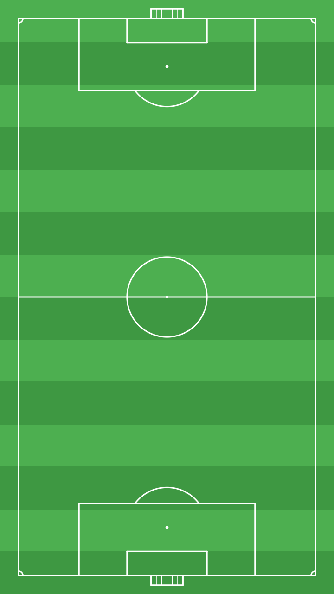

# ⚽ PenalBot — Proyecto de App Inventor

Proyecto completo para **MIT App Inventor 2** armado a partir de los bloques y las
imágenes de la consigna: un balón que se lanza con un gesto (*fling*) sobre una
cancha de fútbol, rebota en los bordes del lienzo y pierde velocidad en cada
rebote hasta detenerse.



## Cómo se juega

1. Se abre la app: aparece la cancha con el balón al centro y el contador en
   `Rebotes: 0`.
2. Se arrastra el dedo sobre el balón y se suelta con un gesto rápido (fling).
3. El balón sale en la dirección del gesto a velocidad 50 y rebota en los bordes
   del lienzo. En cada rebote pierde 10 de velocidad, hasta detenerse.
4. El botón **Reiniciar balón** devuelve el balón al centro y pone el contador a 0.

## Contenido del repositorio

```
.
├── appinventor/
│   ├── PenalBot.aia                     <- proyecto listo para importar
│   └── PenalBot/                        <- fuentes del proyecto (mismo contenido)
│       ├── assets/
│       │   ├── campo.png
│       │   └── balon.png
│       ├── src/appinventor/ai_alumno/PenalBot/
│       │   ├── Screen1.scm              <- diseñador (componentes y propiedades)
│       │   └── Screen1.bky              <- bloques
│       └── youngandroidproject/project.properties
├── assets/                              <- imágenes originales del proyecto
│   ├── campo.png                        (720 x 1280, cancha vertical)
│   └── balon.png                        (512 x 512, PNG con transparencia)
├── docs/
│   └── guia-paso-a-paso.md              <- tutorial para rehacerlo desde cero
├── herramientas/
│   ├── generar_assets.py                <- genera las dos imágenes (sin dependencias)
│   ├── construir_aia.py                 <- escribe el .scm, valida y empaqueta el .aia
│   └── simular_logica.py                <- simula los bloques y verifica el comportamiento
└── README.md
```

## Importar el proyecto

1. Entrar a <https://ai2.appinventor.mit.edu> con una cuenta de Google.
2. **Proyectos → Importar proyecto (.aia) desde mi computadora**.
3. Elegir `appinventor/PenalBot.aia` y confirmar.
4. Abrir el proyecto y probarlo con **AI Companion** (o compilar el APK con
   *Build → Android App (.apk)*).

El proyecto está guardado con la versión de formato `YaVersion 237`
(nb2025/nb2026). Si se importa en un servidor más nuevo, App Inventor actualiza
el proyecto automáticamente.

## Diseñador (Screen1)

| Componente | Tipo | Propiedades principales |
|---|---|---|
| `Screen1` | Screen | `Title` = *Penales LOBOS BUAP*, `AlignHorizontal` = centro, `Sizing` = Responsive, `BackgroundColor` = verde oscuro `#0B2E0B` |
| `LblTitulo` | Label | Texto *Arrastra el balón para patearlo*, ancho *Fill parent*, letra blanca, fondo `#14532D`, centrado |
| `Lienzo1` | Canvas | `BackgroundImage` = `campo.png`, `Width` y `Height` = *Fill parent* (ocupa el resto de la pantalla) |
| `Bola` | ImageSprite (dentro de `Lienzo1`) | `Picture` = `balon.png`, `Width` = `Height` = 44, `X` = 150, `Y` = 280, `Speed` = 0, `Heading` = 0, `Enabled` = verdadero |
| `FilaInferior` | HorizontalArrangement | Ancho *Fill parent*, centrado horizontal y vertical |
| `BtnReiniciar` | Button | Texto *Reiniciar balón*, forma redondeada, fondo `#14532D` |
| `LblRebotes` | Label | Texto `Rebotes: 0`, letra blanca, tamaño 16 |

> El orden de los componentes importa: `LblTitulo` arriba, `Lienzo1` en el medio
> (con *Fill parent* para quedarse con todo el espacio libre) y `FilaInferior`
> abajo.

## Bloques

### 1. Variable global

```
inicializar global rebotes como 0
```

### 2. Al iniciar la pantalla

```
cuando Screen1 .Inicializar
hacer   poner Bola .Velocidad como 0
        poner LblRebotes .Texto como "Rebotes: 0"
```

### 3. Cuando se lanza el balón (bloque de la consigna)

```
cuando Bola .Lanzado          x  y  velocidad  dirección  velx  vely
hacer   poner Bola .Dirección como [tomar dirección]
        poner Bola .Velocidad como 50
        llamar Bola .MoverA  x: [tomar x]  y: [tomar y]
```

* `Lanzado` es el evento **Flung** del sprite: entrega las coordenadas del gesto,
  la velocidad y la dirección del *fling* (los ejes `velx`/`vely` no se usan).
* `poner Dirección como [tomar dirección]` copia el ángulo del gesto al sprite.
* `poner Velocidad como 50` lo pone en movimiento (el sprite se mueve solo, cada
  100 ms, esa cantidad de píxeles).
* `MoverA x, y` lleva el balón al punto donde se soltó el dedo.

### 4. Cuando el balón toca un borde (bloque de la consigna, con mejora)

```
cuando Bola .BordeAlcanzado   borde
hacer   llamar Bola .Rebotar  borde:[tomar borde]
        si  Bola .Velocidad  >  10
        entonces  poner Bola .Velocidad como ( Bola .Velocidad  -  10 )
        si no     poner Bola .Velocidad como 0
        poner global rebotes como ( global rebotes + 1 )
        poner LblRebotes .Texto como unir "Rebotes: " global rebotes
```

* `Rebotar(borde)` invierte el ángulo según el lado que se tocó; hay que pasarle
  el `borde` que entrega el evento.
* En la captura original se hacía `poner Velocidad como Velocidad - 10` sin
  condición. Acá se agregó el `si`: cuando la velocidad llega a 10 o menos se
  pone en 0, porque una velocidad **negativa** haría que el balón se mueva al
  revés y nunca se detenga.
* Las dos últimas líneas son el marcador de rebotes (opcional, no estaban en la
  captura).

### 5. Botón reiniciar

```
cuando BtnReiniciar .Clic
hacer   poner global rebotes como 0
        poner LblRebotes .Texto como "Rebotes: 0"
        poner Bola .Velocidad como 0
        llamar Bola .MoverA
               x:( ( Lienzo1 .Ancho / 2 ) - 22 )
               y:( ( Lienzo1 .Alto / 2 ) - 22 )
```

Dividir el ancho y el alto del lienzo entre 2 y restarle 22 (la mitad de los
44 px del balón) deja el balón exactamente al centro en cualquier pantalla, sin
depender de coordenadas fijas. El origen del `ImageSprite` es su esquina
superior izquierda.

## Verificación

Los scripts del repositorio se pueden volver a ejecutar para comprobar todo:

```bash
python3 herramientas/generar_assets.py    # genera assets/campo.png y assets/balon.png
python3 herramientas/construir_aia.py     # valida bloques/componentes y arma el .aia
python3 herramientas/simular_logica.py    # simula los bloques y verifica el rebote
```

`construir_aia.py` comprueba que el XML de los bloques sea válido, que los ids no
se repitan, que todos los eventos, métodos y propiedades usados existan en el
componente correspondiente, que las variables globales estén declaradas y que
las imágenes referenciadas estén dentro del `.aia`.

`simular_logica.py` reproduce la lógica de los bloques (dirección, velocidad 50,
rebote y resta de 10, contador, reinicio) y confirma con aserciones que el balón
nunca sale del lienzo, que rebota 5 veces y que termina detenido:

```
('lanzado', 50, 45)
('borde', 'Este', 40, 1)
('borde', 'Norte', 30, 2)
('borde', 'Oeste', 20, 3)
('borde', 'Este', 10, 4)
('borde', 'Sur', 0, 5)
Velocidad final: 0
```

## Notas sobre las imágenes

Las dos imágenes de `assets/` son **recreaciones** de las que acompañan la
consigna (la cancha con franjas verdes y líneas blancas, y el balón blanco y
negro), generadas con `herramientas/generar_assets.py` para que el proyecto sea
reproducible y sin dependencias. Si se quieren usar los archivos originales,
basta con reemplazar `assets/campo.png` y `assets/balon.png` manteniendo los
nombres y volver a correr `python3 herramientas/construir_aia.py`.

El escudo *LOBOS BUAP* del centro de la cancha original no se reprodujo (es una
marca); se puede agregar como imagen propia si el docente lo pide.

## Mejoras propuestas para clase

* Sonido de golpe en cada rebote (`Sound.Play` dentro de `BordeAlcanzado`).
* Un `ImageSprite` de arco/portería y detección de gol con `ColisionaCon`.
* Cambiar la velocidad inicial o la pérdida por rebote con un `Slider`.
* Guardar el récord de rebotes con `TinyDB`.
